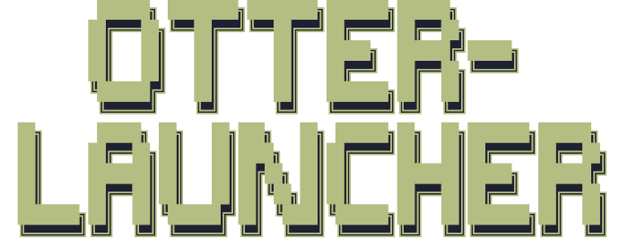
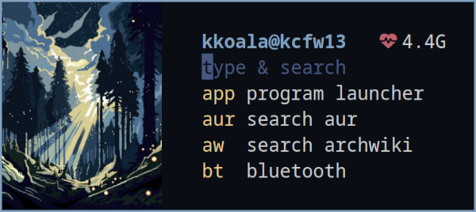
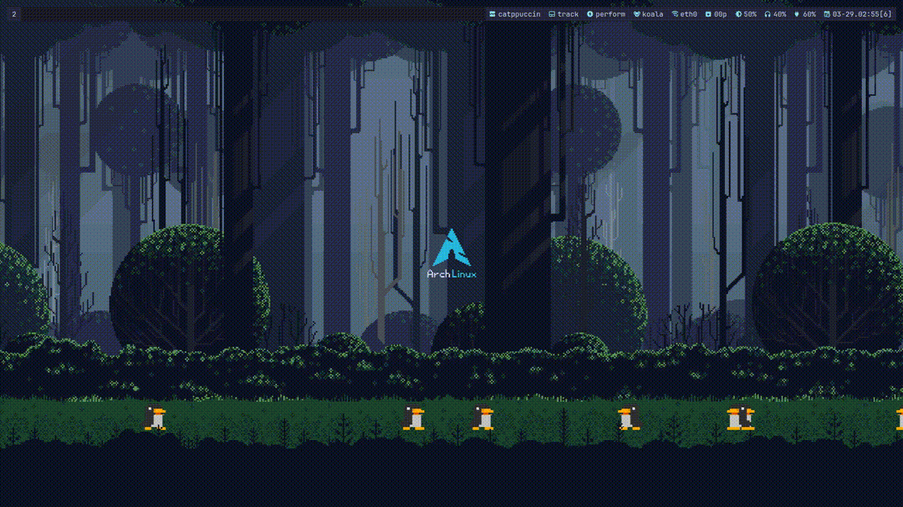
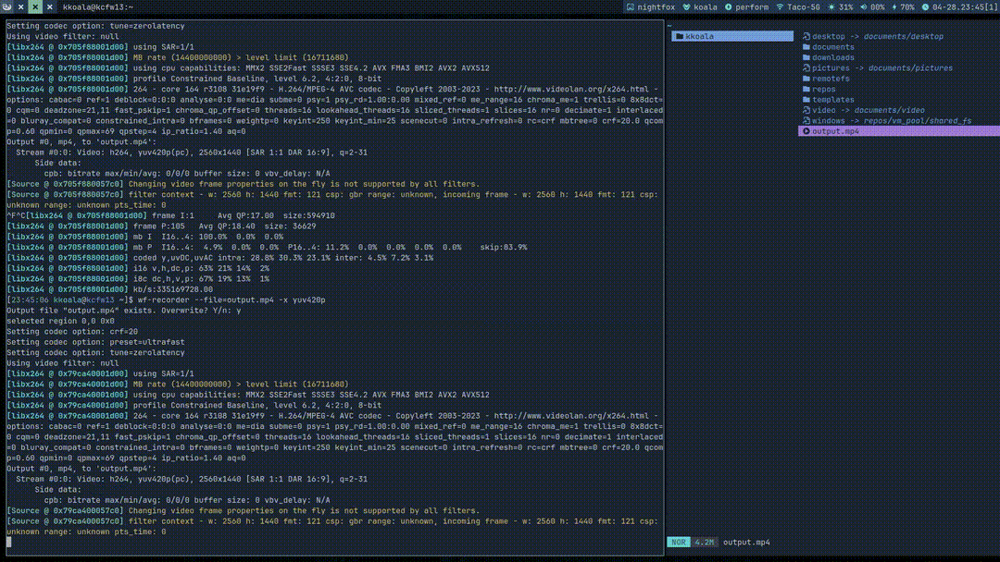
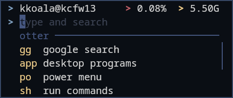
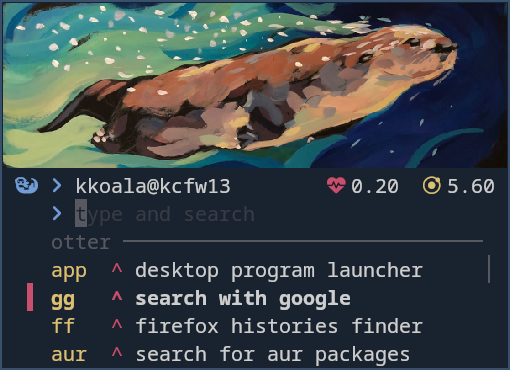
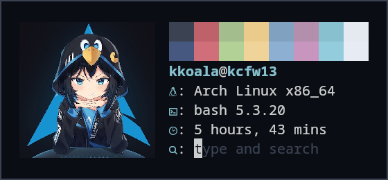
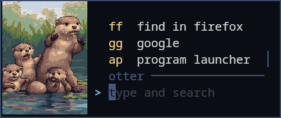
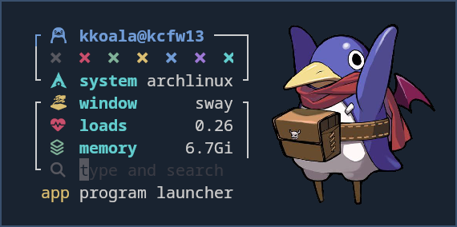
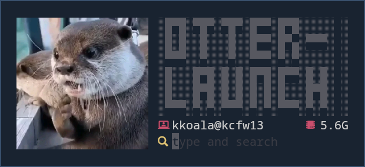

<div align="center">



*minimalist, blazingly fast, keyboard-centric*

  
  

</div>

> Since v0.8.0, otter-launcher has rebased its backend to ratatui, which is a breaking change. Read the [release note](https://github.com/kuokuo123/otter-launcher/releases/tag/v0.8.0) to know how to migrate the old config files.

## Overview

A very hackable app launcher, designed for keyboard-centric wm users. It is blazingly fast, supports vi and emacs keybinds, and can be decorated with ansi color codes, sixel or kitty image protocols.

The core concept is making these behaviours possible with a TUI:

- type "gg margaret thatcher" to google the lady in a web browser
- "sh htop" to run htop in a terminal
- "dc linux" to search the word linux with an online dictionary
- "app" to launch application menu
- etc.

There's also a CLI usage. Running "otter-launcher gg maragaret" in command line will google it without entering the TUI.

It's recommended to setup a dedicated desktop app launcher as a module, like [fsel](https://github.com/Mjoyufull/fsel) or [sway-launcher-desktop](https://github.com/Biont/sway-launcher-desktop). Some helper scripts can be found in the [contrib](https://github.com/kuokuo123/otter-launcher/tree/main/contrib) folder, modules in [wiki](https://github.com/kuokuo123/otter-launcher/wiki).

<div align="center">



</div>

## Table of Contents

- [Overview](#overview)
- [Features](#features)
- [Demo](#demo)
- [Installation](#installation)
- [Configuration](#configuration)
- [Integration](#integration)
- [Styling](#styling)
- [Sponsorship](#sponsorship)

## Features

- modularized to run different commands
- vi and emacs keybinds
- two suggestion modes: list & hint
- tab completion; tab again to undo completion
- edit prompt in an external editor (vim, emacs, etc.)
- url encoding for web searching
- show image through sixel or kitty graphics, or chafa symbols
- cheat sheet
- customizable shell by which programs are launched (sh -c, zsh -c, hyprctl dispatch exec, etc)
- cli mode to launch modules directly (eg. "otter-launcher app" to enter app menu directly)
- minimalist, blazingly fast, keyboard-centric

## Demo

> Workflow

<div align="center">



</div>

>External editor, list selection, and cheatsheet

<div align="center">



</div>

## Installation

### With the AUR

``` bash
paru -S otter-launcher
```

### Building from source

``` bash
git clone https://github.com/kuokuo123/otter-launcher /tmp/otter-launcher
cd /tmp/otter-launcher
cargo build --release
mkdir -p $HOME/.config/otter-launcher
cp /tmp/otter-launcher/config_example/config.toml $HOME/.config/otter-launcher/config.toml
sudo cp /tmp/otter-launcher/target/release/otter-launcher /usr/bin/
```

## Configuration

Otter reads from $HOME/.config/otter-launcher/config.toml. If missing, it looks into /etc/otter-launcher/config.toml, which is included in the AUR installation. Use the '--config' or '-c' flag to specify your preferred path otherwise.

The [default config](https://github.com/kuokuo123/otter-launcher/tree/main/config_example/config.toml) comes only with a minimal setup. Check [more examples](https://github.com/kuokuo123/otter-launcher/wiki) for module setup, [styling](#styling) for image integration.

<div align="center">



</div>

All the available options are listed here.

``` toml
[general]
height = 7 # the total lines that otter-launcher should occupy
empty_module = "app" # module to run with an empty prompt
default_module = "gg" # module to run when no module is matched
alternative_module = "" # module to run with alt+enter
control_module = "" # module to run with ctrl+enter
exec_cmd = "sh -c" # your chosen shell, eg. "zsh -c" for zsh; also accept wm commands like "hyprctl dispatch exec"
vi_mode = false # true for vi keybinds, false emacs keybinds
cheatsheet_entry = "?" # the key to show configured modules
cheatsheet_viewer = "less -R; clear" # command to show cheatsheet; through piping stdout
external_editor = "vi" # ctrl+x ctrl+e (or v in vi normal mode)


[interface]
# options for the layout
padding = [0, 1, 0, 1] # pad with columns/lines, [top, right, down, left]
# use three quotes to write longer codes; ANSI color codes and shell expansion are allowed
header = """
$(
load=$(awk 'NR == 1 {print $1"%"}' /proc/loadavg)
mem=$(free -h | awk 'NR == 2 {print $3}' | sed 's/Gi/0G/')

left="$USER@$HOSTNAME"
left="> $left"
right="> $load%  > $mem"

gap=$(( COLUMNS - ${#left} - ${#right} ))
(( gap < 0 )) && gap=0

printf '\x1b[34;1m> \x1b[0m%s@%s%*s\x1b[31;1m> \x1b[0m%s  \x1b[33;1m> \x1b[0m%s' "$USER" "$HOSTNAME" "$gap" '' "$load" "$mem")"""
# available [color options](https://docs.rs/ratatui/latest/ratatui/prelude/enum.Color.html)
header_color = "blue"
# options for input field
prompt_sign = "> "
prompt_sign_color = "blue"
place_holder = "type & search"
# options for selectable suggestions
suggestion_mode = "list" # available options: list, hint
suggestion_position = "bottom" # to the input field; options: top, bottom
prefix_color = "yellow"
prefix_padding = 3 # pad with spaces to have uniformed width
description_color = "reset"
selection_prefix = "▌ " # shown for the selected
selection_prefix_color = "red"
inverse_selection = true # highlight the selected
list_prefix = "  " # shown for the not selected
list_prefix_color = "reset"
indicator_args = "" # shown for modules taking arguments
indicator_bare = "" # for those not taking arguments
indicator_color = "red"
scrollbar = true
# options for separator
separator = true # draw a line between intput field and suggestion list; only affect list mode
separator_label = "  otter "


[image]
format = "symbol" # graphics protocols to use; options: kitty, sixel, iterm2, symbol
path = "" # path to the image file
width = 12 # the size of image; count columns for horizontal layout, lines for vertical layout
position = "left" # image placement; options: left, right, top, bottom
padding = [0, 0, 0, 0] # [top, right, down, left]


# modules are defined as followed
[[modules]]
description = "google search"
prefix = "gg"
cmd = "xdg-open https://www.google.com/search?q='{}'"
# if with_argument is true, {} in cmd will be replaced with user input. if not explicitly set, taken as false.
with_argument = true
# url_encode should be true when calling webpages; this ensures special characters in url being readable to browsers; taken as false if not explicitly set
url_encode = true
# run cmd in a forked shell as opposed to as a child process (simply by prepending setsid -f to the configured cmd); useful for launching gui programs; taken as false if not explicitly set
unbind_proc = true

# fzf is needed to run below functions
[[modules]]
description = "desktop programs"
prefix = "app"
cmd = """
desktop_file() {
find /usr/share/applications -name "*.desktop" 2>/dev/null
find /usr/local/share/applications -name "*.desktop" 2>/dev/null
find "$HOME/.local/share/applications" -name "*.desktop" 2>/dev/null
find /var/lib/flatpak/exports/share/applications -name "*.desktop" 2>/dev/null
find "$HOME/.local/share/flatpak/exports/share/applications" -name "*.desktop" 2>/dev/null
}
selected="$(desktop_file | awk -F/ '{name=$NF; sub(/\\.desktop$/, "", name); print name}' | sort -k1,1 | cut -f2- | fzf --cycle --gutter ' ' --color 'pointer:1,info:8,separator:8,scrollbar:0' -m -d / --with-nth -1 )"
[ -z "$selected" ] && exit
echo "$selected" | while read -r line ; do setsid -f gtk-launch "$(basename $line)"; done
"""

[[modules]]
description = "power menu"
prefix = "po"
cmd = """
function power {
if [[ -n $1 ]]; then
case $1 in
"logout") session=`loginctl session-status | head -n 1 | awk '{print $1}'`; loginctl terminate-session $session ;;
"suspend") systemctl suspend ;;
"hibernate") systemctl hibernate ;;
"reboot") systemctl reboot ;;
"shutdown") systemctl poweroff ;;
esac fi }
power $(echo -e 'reboot\nshutdown\nlogout\nsuspend\nhibernate' | fzf --cycle --gutter ' ' --color 'pointer:1,info:8,separator:8,scrollbar:0' | tail -1)
"""

[[modules]]
description = "run commands"
prefix = "sh"
cmd = """
$(printf $TERM | sed 's/xterm-//g') -e sh -c "{}"
"""
with_argument = true
unbind_proc = true

[[modules]]
description = "search archwiki"
prefix = "aw"
cmd = "xdg-open https://wiki.archlinux.org/index.php?search='{}'"
with_argument = true
url_encode = true
unbind_proc = true

[[modules]]
description = "search packages"
prefix = "pac"
cmd = "xdg-open https://archlinux.org/packages/?q='{}'"
with_argument = true
url_encode = true
unbind_proc = true

[[modules]]
description = "search the AUR"
prefix = "aur"
cmd = "xdg-open https://aur.archlinux.org/packages?K='{}'"
with_argument = true
url_encode = true
unbind_proc = true

[[modules]]
description = "cambridge dict"
prefix = "dc"
cmd = "xdg-open 'https://dictionary.cambridge.org/dictionary/english/{}'"
with_argument = true
url_encode = true
unbind_proc = true

[[modules]]
description = "open files (fzf)"
prefix = "fo"
cmd = """
find $HOME -type f -not -path '*/.cache/*' 2>/dev/null | fzf --cycle --gutter ' ' --color 'pointer:1,info:8,separator:8,scrollbar:0' | setsid -f xargs -r -I [] xdg-open '[]'
"""

[[modules]]
description = "open dirs (yazi)"
prefix = "yz"
cmd = """
find $HOME -type d -not -path '*/.cache/*' 2>/dev/null | fzf --cycle --gutter ' ' --color 'pointer:1,info:8,separator:8,scrollbar:0' | xargs -r -I [] setsid -f "$(echo $TERM | sed 's/xterm-//g')" -e yazi '[]'
"""
```

## Integration

Otter-launcher works well with tui programs and bash pipelines. Some tricktips:

1. Use your wm's window rules to control window size; make it large enough to prevent a skewed layout.

2. [[modules]].cmd can be scripted to adjust window sizes. For example:

``` toml
[[modules]]
description = "pulsemixer for audio control"
prefix = "vol"
cmd = "swaymsg [app_id=otter-launcher] resize set width 600 px height 300 px; pulsemixer; swaymsg [app_id=otter-launcher] resize set width 600 px height 60 px"
```

3. Some tui utilities that works really well:

    - Desktop app launcher: [sway-launcher-desktop](https://github.com/Biont/sway-launcher-desktop) [fsel](https://github.com/Mjoyufull/fsel)
    - Audio control: [pulsemixer](https://github.com/GeorgeFilipkin/pulsemixer) [wiremix](https://github.com/tsowell/wiremix)
    - Bluetooth control: [bluetui](https://github.com/pythops/bluetui) [bluetuith](https://github.com/darkhz/bluetuith)
    - Wifi control: [nmtui](https://archlinux.org/packages/extra/x86_64/networkmanager/) [impala](https://github.com/pythops/impala)
    - Spotify: [spotify_player](https://github.com/aome510/spotify-player)
    - Mouse control: [wl-kbptr](https://github.com/moverest/wl-kbptr)
    - More on [Awesome TUIs](https://github.com/rothgar/awesome-tuis) or [Awesome Command Line(CLI/TUI) Programs](https://github.com/toolleeo/awesome-cli-apps-in-a-csv).

4. To change external editor's window size , call a wrapper script at general.external_editor. Examples of such a wrapper are in [contrib](https://github.com/kuokuo123/otter-launcher/tree/main/contrib).

## Styling

### Banner

<div align="center">



[Image Source: Artist Kat Corrigan & MWMO Stormwater Park](https://www.mwmo.org/learn/visit-us/exhibits/waterways-and-otterways/)

</div>

``` toml
[general]
height = 14

[interface]
# Bash scripting widgets in $()
header = """
$(
load=$(awk 'NR == 1 {print $1}' /proc/loadavg)
mem=$(free -h | awk 'NR == 2 {print $3}' | sed 's/Gi/0/')
left="$USER@$HOSTNAME"
left="  > $left"
right="> $load  > $mem"
gap=$(( COLUMNS - ${#left} - ${#right} ))
(( gap < 0 )) && gap=0
printf '\x1b[34;1m   \x1b[0m%s@%s%*s\x1b[31;1m \x1b[0m%s  \x1b[33;1m \x1b[0m%s' "$USER" "$HOSTNAME" "$gap" '' "$load" "$mem")"""
prompt_sign = "    "
padding = [0, 1, 0, 1]
separator_label = "   otter "
list_prefix = "   "
selection_prefix = " ▌ "
inverse_selection = false
suggestion_position = "bottom"
indicator_bare = "$ "
indicator_args = "^ "
prefix_padding = 4

[image]
format = "kitty"
path = "$HOME/.config/otter-launcher/images/images_other/waterways_and_otterways.jpg"
width = 6
position = "top"
```

### Two-liner

<div align="center">


</div>

```toml
[general]
height = 2

[interface]
header = """
$(
load=$(awk 'NR == 1 {print $1}' /proc/loadavg)
mem=$(free -h | awk 'NR == 2 {print $3}' | sed 's/Gi/0 /')

left="$USER@$HOSTNAME"
left="  > $left"
right="> $load  > $mem"

gap=$(( COLUMNS - ${#left} - ${#right} ))
(( gap < 0 )) && gap=0

printf '\x1b[34;1m   \x1b[0m%s@%s%*s\x1b[31;1m \x1b[0m%s  \x1b[33;1m \x1b[0m%s' "$USER" "$HOSTNAME" "$gap" '' "$load" "$mem")"""
prompt_sign = "    "
suggestion_mode = "hint"
```

### Fastfetch

<div align="center">



</div>

Images should be rendered by otter-launcher, and "--pipe false" should be attached to fastfetch itself.

``` toml
[general]
height = 9

[interface]
# Strip fastfetch of the image and use the --pipe flag
header = "$( fastfetch --structure colors:title:os:shell:uptime  --pipe false  --logo none)"
prompt_sign = "\x1b[0m: "
prompt_sign_color = "cyan"
padding = [1, 2, 1, 0]
suggestion_mode = "hint"
suggestion_position = "top"
indicator_bare = "$ "
indicator_args = "^ "

# Let otter handles the image
[image]
format = "kitty"
path = "$HOME/.config/otter-launcher/images/images_squ/archlinux_chan.jpg"
width = 20
padding = [1, 1, 1, 2]
```

### Fzf-like

<div align="center">



</div>

```toml
[general]
height = 7

[interface]
padding = [1, 1, 1, 1]
separator_label = "  otter "
list_prefix = "  "
selection_prefix = "▌ "
inverse_selection = true

[image]
format = "kitty"
path = "$HOME/.config/otter-launcher/images_rec.image"
width = 12
```

### One-liner

<div align="center">


</div>

```toml
[general]
height = 1

[interface]
prompt_sign = " > "
suggestion_mode = "hint"
placeholder = ""
```

### Image to the Right

<div align="center">



</div>

```toml
[general]
height = 10

[interface]
padding = [1, 2, 1, 2]
header = """
 ┌ \u001B[1;34m  $USER@$(echo $HOSTNAME) \u001B[0m───┐
 │ \u001B[90m󱎘  \u001B[31m󱎘  \u001B[32m󱎘  \u001B[33m󱎘  \u001B[34m󱎘  \u001B[35m󱎘  \u001B[36m󱎘\u001B[0m │
 └ \u001B[36m \u001B[1;36m system\u001B[0m archlinux ┘
 ┌ \u001B[33m \u001B[1;36m window \u001B[0m     $XDG_CURRENT_DESKTOP ┐
 │ \u001B[31m \u001B[1;36m loads\u001B[0m       $(cat /proc/loadavg | cut -d ' ' -f 1) │
 │ \u001B[32m \u001B[1;36m memory\u001B[0m     $(free -h | awk 'FNR == 2 {print $3}') │"""
prompt_sign = " └ \u001B[90m \u001B[0m "
prompt_sign_color = "reset"
suggestion_mode = "list"
suggestion_position = "bottom"
inverse_selection = false
separator = false
prefix_padding = 3
list_prefix = "  "
selection_prefix = "  "
scrollbar = false

[image]
padding = [1, 2, 0, 0]
format = "kitty"
path = "$HOME/.config/otter-launcher/images/images_rec/prinny.png"
width = 19
position = "right"
```

### Otter Shocked

<div align="center">



</div>

```toml
[general]
height = 10

[interface]
header = """
\x1b[90m░█▀█░▀█▀░▀█▀░█▀▀░█▀█░░░░░ ░ ░
░█░█░░█░░░█░░█▀▀░█▀▄░▀▀▀░ ░ ░
░▀▀▀░░▀░░░▀░░▀▀▀░▀░▀░░░░░ ░ ░
░█░░░█▀█░█░█░█▀█░█▀▀░█░█░ ░ ░
░█░░░█▀█░█░█░█░█░█░░░█▀█░ ░ ░
░▀▀▀░▀░▀░▀▀▀░▀░▀░▀▀▀░▀░▀░ ░ ░
\x1b[31;1m󱩊 \x1b[0m$USER@$HOSTNAME      \x1b[31;1m󰘚 \x1b[0m$(free -h | awk 'NR == 2 {print $3}' | sed 's/i//')
"""
prompt_sign = " "
prompt_sign_color = "yellow"
padding = [1, 2, 1, 0]
suggestion_mode = "hint"
suggestion_position = "top"
prefix_padding = 3

[image]
format = "kitty"
path = "$HOME/.config/otter-launcher/images/images_squ/otter_shocked.webp"
width = 22
padding = [1, 1, 1, 2]
```

## Sponsorship

If you find the project helpful, you can buy me a coffee through [paypal](https://www.paypal.com/ncp/payment/JMX5G79MQLKKA).

<p align="center">
  <a href="https://www.paypal.com/ncp/payment/JMX5G79MQLKKA">
    
  </a>
</p>
